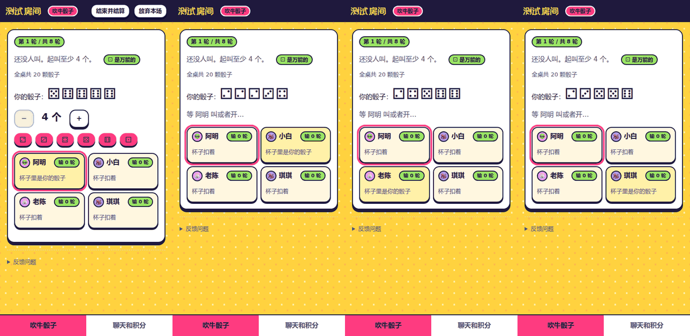
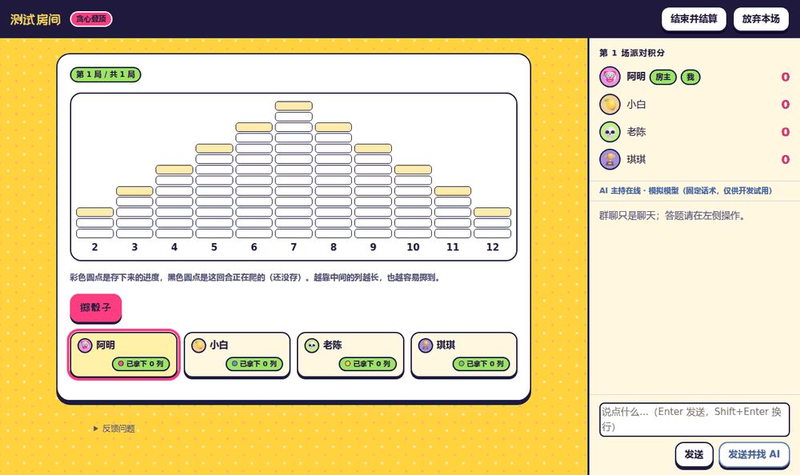
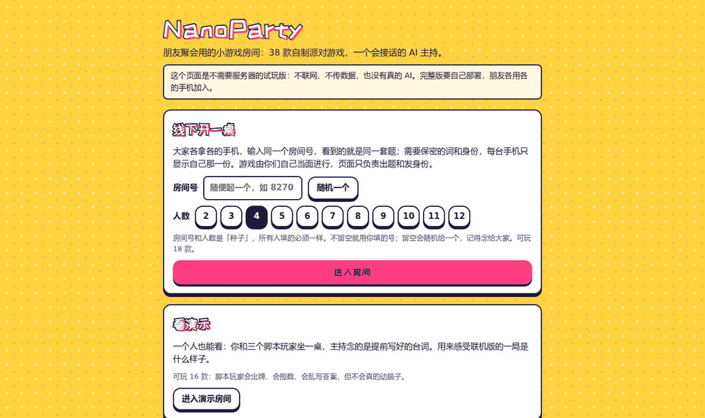
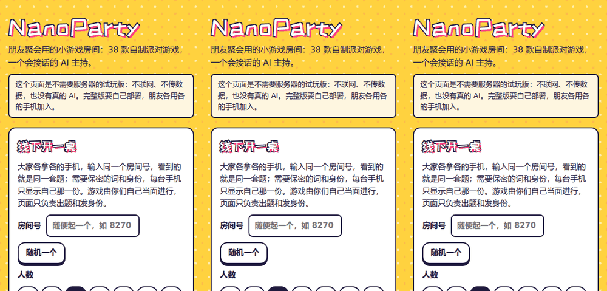

# NanoParty

朋友聚会用的网页小游戏房间：大家在外面开着语音，各自用手机或电脑进同一个房间，玩猜词、诈唬、投票和卡牌游戏，旁边有一个共享的 AI 主持接话、出题、当裁判。源码公开，自己部署，数据在自己手里。

**在线试玩（静态版，不需要服务器，没有真的 AI）：<https://party.traceonsnow.com>**



<sub>完整版：四个人各用各的手机在同一个房间。公共信息所有人一样，自己的骰子只在自己屏幕上。</sub>

## 这是什么

- **38 款派对游戏**，都跑在同一套房间、计时、积分和断线恢复之上。
- **AI 主持是可选的**：配了模型，它会在群聊里接话、按主题出题、主持海龟汤；不配，所有游戏照常能玩。
- **两种用法**：完整版自己部署，朋友凭邀请链接加入；静态版是一组纯静态文件，用来试玩和线下聚会时发题、发身份。

| | |
| --- | --- |
|  |  |
| 桌面端：左边是游戏，右边是积分、群聊和 AI 主持 | 静态版的演示：一个真人加三个脚本玩家，主持念预先写好的台词 |



<sub>静态版的「线下开一桌」：手机之间不联网，输入同一个房间号就是同一套题，每台手机只显示自己那一份。</sub>

## 游戏

**出题和聊天类（22 款）**：猜刻度 · 谁是卧底 · 逛三园 · 排排座 · 真假难辨 · 估数字 · 估数下注 · 谁最可能 · 脑洞问答 · 不撞词 · 海龟汤 · 五五开 · 问出秘密词 · 暗号网格 · 密码传递 · 禁词描述 · 词块描述 · 四叶联想 · 猜大家选 · 百分比竞猜 · 撞答案 · 地点疑云

**卡牌、骰子和纯规则类（16 款）**：别拿第六张 · 合作吃墩 · 翻牌诈唬 · 拒牌筹码 · 压牌出清 · 暗牌对决 · 凑一桌 · 攒七张 · 贪心登顶 · 别翻重 · 盲念咒语 · 吹牛骰子 · 探洞寻宝 · 心照不宣 · 黑暗料理 · 烟花接龙

每款的完整规则在 [docs/games/](docs/games/)。这些游戏借鉴的是常见聚会游戏和桌游的机制，名称、题目、牌面和分值都是本项目自定的。

平台提供的：长期房间和多场派对、每场独立计分和回顾、轮流选题（可以换一批、自己出题、让 AI 出题）、房主确认后才入账的派对积分、协商加分扣分、投票跳题、断线重连和重启恢复。

## 设计上在意的几件事

这个项目想验证的是：让一个大模型坐进多人游戏里当主持，但不让它有机会把游戏搞坏。几条贯穿全部代码的约束：

- **规则是确定性的纯函数。** 每款游戏是一个模块（`setup / apply / view`），不做 IO、不读时钟、不用 `Math.random`、不调用模型。加一款游戏不需要碰房间、网络和数据库。
- **秘密只在服务端。** 客户端只会收到「这个玩家该看到的视图」，AI 主持只看得到公开摘要。有秘密的游戏都带一条测试：别人的视图里不出现你的手牌、词或身份。
- **AI 不控制规则。** 主持只能通过一组受控工具行动，每个工具执行时重新检查状态和权限；模型说了什么都不能直接改成绩。需要看谜底的工作（比如海龟汤裁判）走另一条通道，只返回「是 / 否 / 无关」这样的小结构。
- **先写库，再生效。** 每个房间的状态变更串行执行，事务提交之后才更新内存和广播；成绩是只追加的流水，重复结算自动忽略。
- **Mock 不是真模型。** 自动化测试用假模型；关于模型表现的结论只来自真实模型评测，并写明模型名（见 `reports/artifacts/model-*.md`）。

更完整的说明：[docs/architecture.md](docs/architecture.md)、五篇决策记录 [docs/adr/](docs/adr/)。

技术栈：TypeScript（strict）、React、Colyseus（WebSocket 房间）、PostgreSQL + Drizzle（开发时用内嵌的 PGlite）、Zod、Vitest、Playwright、Docker Compose。

## 跑起来

**只想看看**：打开 <https://party.traceonsnow.com>。

**本地开发**（需要 Node.js ≥ 22 和 pnpm 11，不需要 Docker 或数据库）：

```bash
pnpm install
cp .env.example .env      # 设置 ADMIN_PASSWORD 即可
pnpm dev                  # 服务端 :3000 + 网页 :5173
```

**一个人试多人房间**：

```bash
AI_MOCK=true pnpm dev:test    # 然后打开 http://localhost:3100/test
```

**自己部署给朋友玩**：

```bash
cp .env.example .env      # 设置 ADMIN_PASSWORD 和 POSTGRES_PASSWORD
docker compose up -d --build
```

| 想做什么 | 看哪里 |
| --- | --- |
| 部署、升级、备份、HTTPS | [docs/deploy.md](docs/deploy.md) |
| 配置 AI 主持（Anthropic / Gemini / DeepSeek） | [docs/ai.md](docs/ai.md) |
| 测试命令、多人测试、试玩报告、私有内容包 | [docs/development.md](docs/development.md) |
| 静态版怎么构建和部署 | [docs/static-demo.md](docs/static-demo.md) |
| 新增一款游戏、代码约定 | [AGENTS.md](AGENTS.md) |
| 最初的产品需求 | [AI_Party_Room_PRD_v1.0.md](AI_Party_Room_PRD_v1.0.md)、[增量 v1.1](docs/NanoParty_VNext_PRD_v1.1.md) |

## 测试

```bash
pnpm check        # lint + 类型检查 + 全部测试
```

- 352 条自动化测试：每款游戏的规则单测、房间运行时、Agent 工具、HTTP + WebSocket 端到端。
- 多个隔离浏览器会话的验收脚本在 `tools/browser/`，截图证据在 `reports/artifacts/browser/`。
- README 里的动图由 `node tools/media/record.mjs` 录制，可以重新生成。

## 现在的状态

这是一个和朋友玩、顺便做实验的项目，不是一个打磨完的产品：

- 只有一部分游戏在真实朋友局里玩过；最近加的十款（贪心登顶到烟花接龙）只经过自动化测试和浏览器检查，没有人完整玩过。
- 内置题库约 1300 条，来源见 [docs/content-sources.md](docs/content-sources.md)。只有一小部分事实题逐条核对过，其余标记为「未核实」，仅供娱乐。
- 没有画画类游戏，没有公开的联机实例。
- 界面和文档只有中文。

## 仓库结构

```
apps/server      Node 服务端：REST、实时房间、Agent、内容系统、数据库
apps/web         React 网页（含静态版入口 src/demo）
packages/shared  游戏内核契约（GameModule）与前后端协议类型
packages/games   游戏模块与内置题库（纯函数，无 IO）
docs/            架构说明、决策记录、各游戏规则规格
tools/           测试玩家、浏览器验收、模型评测、动图录制
```

## 许可

[PolyForm Noncommercial License 1.0.0](LICENSE.md)：可以自由用于个人和其他非商业用途（自己部署和朋友玩、学习、修改、分享）；不允许商业使用。内置题库与代码采用相同许可。
